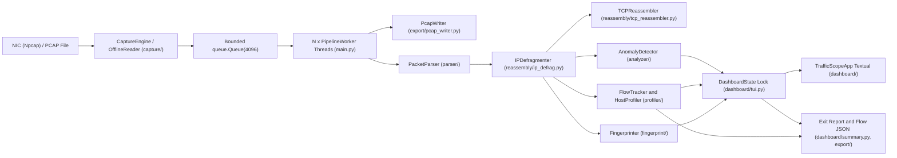

# TrafficScope


**TrafficScope** is a multi-threaded Windows network sniffer and passive traffic analyzer built in Python 3.11+. Rather than simply dumping raw packet headers, it dissects traffic up to the application layer, defragments IP datagrams, reconstructs bidirectional TCP streams, detects protocol anomalies and passive scan signatures, profiles per-host statistical baselines and payload Shannon entropy, passively fingerprints operating systems, renders a live Textual TUI dashboard, and exports Wireshark-compatible PCAPs plus NetFlow-style JSON flow records.

> **Disclaimer:** TrafficScope is strictly for educational, diagnostic, and portfolio use on **your own machine or networks you explicitly own or have written authorization to monitor**. It operates purely passively and never transmits probe or active scan packets.

---

## Architecture

TrafficScope enforces strict separation of concerns around a non-blocking producer-consumer pipeline:



### Project Layout

| Module | Responsibility |
| --- | --- |
| `capture/` | Raw live packet capture (`CaptureEngine`), offline PCAP replay (`OfflineReader`), Windows admin check, and Npcap interface selection |
| `parser/` | Stateless layer-by-layer dissection (`Ethernet/Loopback -> IPv4/IPv6 -> TCP/UDP/ICMP -> HTTP/DNS/TLS ClientHello`) returning an immutable `ParsedPacket` |
| `reassembly/` | IPv4 datagram defragmentation (`IPDefragmenter`) and sequence-ordered TCP stream reassembly (`TCPReassembler`) |
| `analyzer/` | Fully decoupled rule engine (`ChecksumRule`, `TTLRule`, `FlagRule`, `ScanDetector`) emitting rate-limited `Alert` objects |
| `profiler/` | 5-tuple `FlowTracker`, byte-level `shannon_entropy`, and rolling per-host z-score deviation detection (`HostProfiler`) |
| `fingerprint/` | Passive TCP SYN OS/device fingerprinting matched against an extendable local JSON database (`fingerprint/db/fingerprints.json`) |
| `dashboard/` | Live Textual TUI (`TrafficScopeApp`) and Rich-formatted shutdown statistics report (`print_exit_report`) |
| `export/` | Thread-safe `PcapWriter` (libpcap format readable in Wireshark/tshark/Suricata) and versioned NetFlow-style JSON `FlowExporter` |
| `main.py` | CLI parser and thread orchestrator (contains zero scanning or dissection logic) |
| `benchmark.py` | Standalone replay benchmark logging throughput to `docs/benchmark_results.md` |
| `tests/` | Admin-free `pytest` suite driven by synthetic Scapy-crafted packets |

---

## Windows 10/11 Setup

### Prerequisites

1. **Python 3.11+** (tested on Python 3.13.13, 64-bit Windows 11). Ensure **Add Python to PATH** is checked during installation.
2. **Npcap**: Download from [npcap.com](https://npcap.com). During installation, check **"Install Npcap in WinPcap API-compatible Mode"** (required by Scapy on Windows).
3. **Administrator Terminal**: Live packet capture requires running Windows Terminal or PowerShell via **Run as administrator**. TrafficScope detects missing elevation at startup and exits with guidance. Offline `--read` replay, unit tests, and benchmarks do **not** require elevation.

### Installation

```powershell
git clone https://github.com/Jaindu-Net/CodeAlpha_TrafficScope.git
cd CodeAlpha_TrafficScope

python -m venv .venv
.venv\Scripts\Activate.ps1

pip install -r requirements.txt
```

> **Note:** If PowerShell blocks script activation, run `Set-ExecutionPolicy -Scope CurrentUser RemoteSigned` once.

### Verify Npcap Detection

```powershell
python -c "from capture import list_interfaces; print(list_interfaces())"
```

---

## Usage & CLI Reference

```powershell
# List detected interfaces
python main.py --iface ?

# Live capture with the Textual TUI dashboard (Administrator terminal)
python main.py --iface "Wi-Fi" --dashboard

# Capture HTTP traffic, save PCAP + *_flows.json, stop after 1,000 packets
python main.py --iface "Ethernet" --filter "tcp port 80" --save capture.pcap --count 1000

# Replay an existing PCAP offline with the dashboard (no admin needed)
python main.py --read capture.pcap --dashboard

# Run 60-second capture with 2 workers, 120s baseline learning window, and verbose output
python main.py --iface "Wi-Fi" --timeout 60 --threads 2 --baseline-seconds 120 --verbose
```

| Flag | Default | Description |
| --- | --- | --- |
| `--iface` | interactive prompt | Interface name, list index, NPF GUID, or `?` to list interfaces |
| `--filter` | `None` | BPF capture filter expression (e.g., `"tcp port 80"`) |
| `--count` | `None` | Stop after capturing/reading `N` packets |
| `--timeout` | `None` | Stop live capture after `N` seconds |
| `--save` | `None` | Write captured packets to `.pcap` and flow summaries to `<stem>_flows.json` |
| `--read` | `None` | Replay a `.pcap` file offline instead of live NIC capture |
| `--threads` | `min(4, cpu_count-1)` | Parallel worker thread count |
| `--no-payload` | `False` | Strip `Raw` payload bytes before queuing (privacy/memory saving) |
| `--payload-bytes` | `None` | Truncate `Raw` payload bytes per packet to `N` bytes |
| `--dashboard` | `False` | Launch the live Textual TUI dashboard |
| `--baseline-seconds` | `60.0` | Warmup period before flagging host traffic rate z-score deviations |
| `--syn-threshold` | `20` | Unanswered SYNs per 10s window before flagging `SYN_FLOOD` |
| `--port-threshold` | `15` | Distinct destination ports per 10s window before flagging `PORT_SWEEP` |
| `--z-threshold` | `2.5` | Absolute z-score threshold for host statistical rate shifts |
| `--verbose` | `False` | Print dissected packet summaries and live alerts in CLI mode |

---

## Why TCP Reassembly & IP Defragmentation Are Needed

Network traffic arrives as discrete frames, not tidy application messages:

1. **Multi-segment payloads:** An HTTP request or response frequently spans multiple TCP segments. Inspecting individual packets sees only fragments of headers or bodies.
2. **Out-of-order delivery:** Packets routed along different paths can arrive out of sequence (`seq=1028` before `seq=1001`).
3. **Retransmissions & overlaps:** Packet loss triggers TCP retransmissions of sequence ranges already delivered. Without deduplication, reconstructed payloads contain duplicated text.
4. **IP fragmentation:** Large datagrams split across multiple IP fragments only carry the transport header (`TCP`/`UDP`/`ICMP`) in fragment offset `0`.

`IPDefragmenter` reassembles fragmented IPv4 datagrams first (using a first-seen overlap policy and 30s expiry), and `TCPReassembler` tracks per-direction sequence arithmetic (32-bit wraparound-safe), buffers out-of-order segments via sorted sequence offsets, deduplicates retransmissions, handles mid-stream captures, and exposes Wireshark-style `follow_stream()` and `get_http_exchange()` reconstruction.

---

## Benchmark Results

Measured locally via `python benchmark.py --generate 5000` (see [docs/benchmark_results.md](docs/benchmark_results.md)):

- **Environment:** Windows 11 (`Windows-11-10.0.26200-SP0`), Python `3.13.13`, 16 logical CPUs
- **Dataset:** 5,000 synthetic mixed packets (HTTP over TCP, DNS over UDP, TCP SYNs)

| Mode | Workers | Packets | Duration (s) | Sustained Throughput (pps) | MB/s |
| --- | ---: | ---: | ---: | ---: | ---: |
| Raw `PacketParser` Loop | 1 | 5,000 | 0.378 | **13,215.4** | 0.95 |
| Full Analysis Pipeline | 1 | 5,000 | 1.366 | 3,660.8 | 0.26 |
| Full Analysis Pipeline | 2 | 5,000 | 1.314 | **3,805.3** | 0.27 |
| Full Analysis Pipeline | 4 | 5,000 | 1.387 | 3,605.2 | 0.26 |

### Throughput Observation

Throughput peaks around **~3,805 pps** with 2 workers in the full pipeline (`~13,215 pps` for raw dissection alone). Adding 4 workers slightly lowers throughput (`3,605 pps`) because CPU-bound Python bytecode execution shares CPython's GIL alongside short locks in `StreamStore`, `FlowTracker`, and `HostProfiler`. While well above what normal web browsing and file downloads require without queue drops, sustained multi-gigabit line-rate capture would call for a compiled language (Rust/Go/C) or multiprocessing over raw bytes.

---

## Testing

All 40 automated unit and integration tests run without Administrator rights using synthetic Scapy-crafted packets:

```powershell
pytest tests/ -v
```

> **Note:** Live NIC capture and real `nmap` scan detection require running in an elevated Windows terminal with Npcap installed and are validated manually via the acceptance workflow.

---

## Limitations & False Positives

- **NIC Checksum Offloading (`INVALID_CHECKSUM`):** On Windows, outbound packets captured locally are often handed to Npcap before the NIC hardware computes IP/TCP checksums, causing `ChecksumRule` to flag legitimate locally originated packets with `LOW`-severity checksum alerts.
- **Discovery Multicast & Background Chatter (`PORT_SWEEP` / `TTL_ANOMALY`):** `TTLRule` explicitly excludes multicast (`224.0.0.0/4`, `ff00::/8`) and link-local addresses so mDNS/SSDP `TTL=1` traffic does not alert. However, aggressive local service discovery or browser UDP traffic (e.g., QUIC/WebRTC opening many ephemeral ports) can trip low `--port-threshold` values.
- **Baseline Warmup (`HostProfiler`):** During `--baseline-seconds` (default `60s`), rate spikes are intentionally suppressed until sufficient per-second history (`min_history_seconds=5`) accumulates; a sudden burst within the first few seconds of capture will not trigger `STATISTICAL_ANOMALY`.
- **Encrypted Payloads & QUIC/HTTP3:** `tls_parser.py` extracts unencrypted `ClientHello` SNI/ALPN metadata over TCP (`443`/`8443`) and never attempts decryption. UDP-based QUIC Initial handshakes return `None` from the TLS parser and are tracked as `UDP` with high Shannon entropy.
- **Port-Based Application Dispatch:** HTTP/DNS/TLS sub-parsers trigger on standard port sets (`80/8080/3000/8000/8008`, `53/5353`, `443/8443`); HTTP running on unconventional ports will appear as raw `TCP` unless ports are customized.
- **Advanced TCP Edge Cases:** `TCPReassembler` handles 32-bit sequence wraparound, out-of-order segments, retransmissions, and mid-stream prefix ordering, but does not interpret TCP SACK option blocks or TCP Fast Open data inside `SYN` frames.

---

## Legal & Ethical Use

- **Authorized Environments Only:** Run TrafficScope exclusively on loopback (`127.0.0.1`), personal lab VMs, or networks you own or have explicit written permission to inspect.
- **Zero Active Probing:** TrafficScope never injects, crafts, modifies, or transmits network traffic—it inspects copies of frames already delivered to the local host interface.
- **Privacy Awareness:** Packet payloads can contain sensitive tokens or credentials on unencrypted HTTP links. Use `--no-payload` or `--payload-bytes` when demonstrating or capturing in shared environments.

---

## 3-Minute LinkedIn Demo Script

1. **0:00-0:35 — Intro & Architecture:** Briefly show the Mermaid pipeline diagram and run `python main.py --iface ?` in an elevated Windows Terminal to demonstrate interface discovery and privilege checks.
2. **0:35-1:20 — Live Capture & Dashboard:** Launch `python main.py --iface "Wi-Fi" --dashboard --save demo.pcap --baseline-seconds 15`. Open a browser to generate HTTPS (`TLS` SNI), `DNS`, and `HTTP` traffic; point out the live Protocol Breakdown, Top Talkers with passive OS guesses (`Windows 10/11`), and Payload Entropy Heatmap (`green` plaintext vs `red` encrypted TLS).
3. **1:20-2:05 — Reconstructed HTTP Session:** Open a quick Python snippet or `follow_stream()` output on `demo.pcap` (or replay an HTTP exchange) to highlight client/server TCP stream reconstruction across segmented packets.
4. **2:05-2:45 — Passive Scan Detection:** From a second terminal (or authorized VM), run `nmap -sS -sX -p 20-45 <your-local-IP>` against your own machine. Show `SCAN_XMAS`, `PORT_SWEEP`, and `SYN_FLOOD` firing immediately in the red Anomaly Feed without sending a single packet back.
5. **2:45-3:00 — Graceful Exit & Wireshark Verification:** Press `q` in the dashboard to show the Rich exit report (throughput, zero drops, top ports, anomalies), then open `demo.pcap` cleanly in Wireshark and display `demo_flows.json`.
