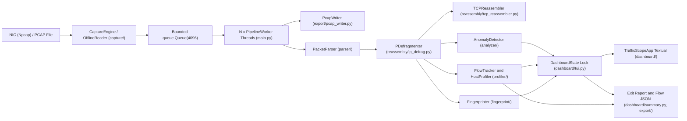

# TrafficScope

> **Advanced Network Packet Sniffer, Stream Reconstructor & Passive Traffic Analyzer**


A multi-threaded Python network monitoring and traffic analysis application for Windows 10/11 that captures live traffic, reconstructs TCP sessions, dissects application protocols, profiles statistical baselines, passively fingerprints operating systems, and visualizes everything in a live terminal dashboard.

---

## Overview

**TrafficScope** (developed for **CodeAlpha_TrafficScope**) goes beyond basic packet dumping by separating capture, protocol dissection, session reassembly, anomaly detection, statistical profiling, passive OS fingerprinting, visualization, and export into strictly decoupled modules around a non-blocking producer-consumer pipeline.

> **Disclaimer:** This tool is strictly for authorized network diagnostics, educational learning, and portfolio use on **your own machine or networks you have explicit permission to monitor**. All detections are potential indicators for investigation—not confirmed attacks. TrafficScope operates purely passively and never transmits probe packets.

---

## Features

### Core Capabilities

- **Real-Time & Offline Packet Capture** — Live sniffing via Scapy + Npcap (`--iface`, `--filter`, `--count`, `--timeout`) plus admin-free PCAP replay (`--read`), with application queue and best-effort Npcap kernel drop counters
- **Non-Blocking Producer-Consumer Pipeline** — Dedicated capture thread pushing into a bounded `queue.Queue(4096)` drained by `N` parallel `PipelineWorker` threads (`--threads`)
- **Layer-by-Layer Protocol Dissection** — Ethernet/Loopback, IPv4/IPv6, TCP/UDP/ICMP/ICMPv6, plus application-layer metadata for **HTTP/1.x** (method, host, path, headers, status), **DNS** (UDP & TCP queries/answers), and **TLS `ClientHello`** (SNI & ALPN without decryption)
- **IP Defragmentation & TCP Stream Reassembly** — Reassembles fragmented IPv4 datagrams (first-seen overlap policy) and out-of-order/retransmitted TCP segments into Wireshark-style conversations (`follow_stream()` and HTTP request/response reconstruction)
- **Decoupled Anomaly & Passive Scan Detection** — Evaluates invalid checksums, impossible TTLs, malformed TCP flag scans (`NULL`, `FIN`, `XMAS`, `SYN+FIN`, reserved bits), SYN bursts, and port sweeps with per-source alert cooldown deduplication
- **Statistical Traffic Profiling & Entropy** — Tracks rolling per-host packet rates (`HostProfiler` z-score deviations after `--baseline-seconds`) and byte-level payload **Shannon entropy** (`plaintext`, `compressed/mixed`, `likely encrypted`)
- **Passive OS/Device Fingerprinting** — Maps observed TCP `SYN` TTL, window size, and TCP option ordering against an extendable JSON signature database (`fingerprint/db/fingerprints.json`)
- **Wireshark & Flow Export** — Thread-safe libpcap `.pcap` writer (`--save`) plus versioned NetFlow-style JSON flow summaries (`<stem>_flows.json`)

### Interfaces

- **CLI Monitor & Exit Summary** — Colored Rich packet logging (`--verbose`) and structured shutdown report (throughput, queue/kernel drops, protocol breakdown, top talkers, top ports, anomalies, and entropy distribution)
- **Live Textual TUI Dashboard** — Interactive full-screen terminal dashboard (`--dashboard`) with real-time panels refreshing every second

---

## Architecture

TrafficScope enforces strict separation of concerns around a non-blocking producer-consumer pipeline:



### Project Layout

| Module | Responsibility |
| --- | --- |
| `capture/` | Raw live packet capture (`CaptureEngine`), offline PCAP replay (`OfflineReader`), Windows admin check, and Npcap interface selection |
| `parser/` | Stateless layer-by-layer dissection (`Ethernet/Loopback -> IPv4/IPv6 -> TCP/UDP/ICMP -> HTTP/DNS/TLS ClientHello`) returning an immutable `ParsedPacket` |
| `reassembly/` | IPv4 datagram defragmentation (`IPDefragmenter`) and sequence-ordered TCP stream reassembly (`TCPReassembler`) |
| `analyzer/` | Fully decoupled rule engine (`ChecksumRule`, `TTLRule`, `FlagRule`, `ScanDetector`) emitting rate-limited `Alert` objects |
| `profiler/` | 5-tuple `FlowTracker`, byte-level `shannon_entropy`, and rolling per-host z-score deviation detection (`HostProfiler`) |
| `fingerprint/` | Passive TCP SYN OS/device fingerprinting matched against an extendable local JSON database (`fingerprint/db/fingerprints.json`) |
| `dashboard/` | Live Textual TUI (`TrafficScopeApp`) and Rich-formatted shutdown statistics report (`print_exit_report`) |
| `export/` | Thread-safe `PcapWriter` (libpcap format readable in Wireshark/tshark/Suricata) and versioned NetFlow-style JSON `FlowExporter` |
| `main.py` | CLI parser and thread orchestrator (contains zero scanning or dissection logic) |
| `benchmark.py` | Standalone replay benchmark logging throughput to `docs/benchmark_results.md` |
| `tests/` | Admin-free `pytest` suite driven by synthetic Scapy-crafted packets |

---

## Windows 10/11 Setup

### Prerequisites

1. **Python 3.11+** (tested on Python 3.13.13, 64-bit Windows 11). Ensure **Add Python to PATH** is checked during installation.
2. **Npcap**: Download from [npcap.com](https://npcap.com/#download). During installation, check **"Install Npcap in WinPcap API-compatible Mode"** (required by Scapy on Windows).
3. **Administrator Terminal**: Live packet capture requires running Windows Terminal or PowerShell via **Run as administrator**. TrafficScope detects missing elevation at startup and exits with guidance. Offline `--read` replay, unit tests, and benchmarks do **not** require elevation.

### Installation

```powershell
git clone https://github.com/Jaindu-Net/CodeAlpha_TrafficScope.git
cd CodeAlpha_TrafficScope

python -m venv .venv
.venv\Scripts\Activate.ps1

pip install -r requirements.txt
```

> **Note:** If PowerShell blocks script activation, run `Set-ExecutionPolicy -Scope CurrentUser RemoteSigned` once.

### Verify Npcap Detection

```powershell
python -c "from capture import list_interfaces; print(list_interfaces())"
```

---

## Usage & CLI Reference

```powershell
# List detected interfaces
python main.py --iface ?

# Live capture with the Textual TUI dashboard (Administrator terminal)
python main.py --iface "Wi-Fi" --dashboard

# Capture HTTP traffic, save PCAP + *_flows.json, stop after 1,000 packets
python main.py --iface "Ethernet" --filter "tcp port 80" --save capture.pcap --count 1000

# Replay an existing PCAP offline with the dashboard (no admin needed)
python main.py --read capture.pcap --dashboard

# Run 60-second capture with 2 workers, 120s baseline learning window, and verbose output
python main.py --iface "Wi-Fi" --timeout 60 --threads 2 --baseline-seconds 120 --verbose
```

| Flag | Default | Description |
| --- | --- | --- |
| `--iface` | interactive prompt | Interface name, list index, NPF GUID, or `?` to list interfaces |
| `--filter` | `None` | BPF capture filter expression (e.g., `"tcp port 80"`) |
| `--count` | `None` | Stop after capturing/reading `N` packets |
| `--timeout` | `None` | Stop live capture after `N` seconds |
| `--save` | `None` | Write captured packets to `.pcap` and flow summaries to `<stem>_flows.json` |
| `--read` | `None` | Replay a `.pcap` file offline instead of live NIC capture |
| `--threads` | `min(4, cpu_count-1)` | Parallel worker thread count |
| `--no-payload` | `False` | Strip `Raw` payload bytes before queuing (privacy/memory saving) |
| `--payload-bytes` | `None` | Truncate `Raw` payload bytes per packet to `N` bytes |
| `--dashboard` | `False` | Launch the live Textual TUI dashboard |
| `--baseline-seconds` | `60.0` | Warmup period before flagging host traffic rate z-score deviations |
| `--syn-threshold` | `20` | Unanswered SYNs per 10s window before flagging `SYN_FLOOD` |
| `--port-threshold` | `15` | Distinct destination ports per 10s window before flagging `PORT_SWEEP` |
| `--z-threshold` | `2.5` | Absolute z-score threshold for host statistical rate shifts |
| `--verbose` | `False` | Print dissected packet summaries and live alerts in CLI mode |

---

## Dashboard

Running with `--dashboard` opens the live **Textual** terminal interface, polling a thread-safe `DashboardState` snapshot every second (press `q` to quit cleanly and view the exit summary).

### Dashboard Sections

- **Header Status Bar** — Active interface/PCAP source, capture status (`LIVE` / `COMPLETE`), elapsed duration, live packets/sec, total packet count, and queue drops
- **Protocol Breakdown** — Live packet counts and percentage shares across Ethernet, IP, transport, and application protocols
- **Top Talkers** — Top 10 IP addresses ranked by byte volume alongside packet counts, primary protocol, and passive OS fingerprint guesses
- **Payload Entropy Heatmap** — Visual 0–8 bits/byte heat bar classifying top payload flows as `plaintext` (green), `compressed/mixed` (yellow), or `likely encrypted` (red)
- **Anomaly Feed** — Auto-scrolling severity-colored log (`HIGH` red, `MEDIUM` yellow, `LOW` dim) of triggered protocol and scan alerts

---

## Anomaly & Threat Detection Rules

| Rule / Alert Type | Condition | Severity |
| --- | --- | --- |
| `INVALID_CHECKSUM` | IPv4 header or TCP/UDP/ICMP checksum fails RFC 1071 verification | `LOW` |
| `TTL_ANOMALY` | Packet arrives with illegal `TTL=0` (`HIGH`) or unicast `TTL<=1` (`MEDIUM`) | `HIGH` / `MEDIUM` |
| `SCAN_NULL` | TCP packet with zero classic control flags set | `MEDIUM` |
| `SCAN_FIN` | TCP packet with only `FIN` set (no `ACK`) | `MEDIUM` |
| `SCAN_XMAS` | TCP packet with `FIN+PSH+URG` set (no `ACK`) | `HIGH` |
| `SYN_FIN_ILLEGAL` | Illegal TCP `SYN+FIN` flag combination | `HIGH` |
| `RESERVED_FLAG` | Non-zero bits set in the TCP reserved header field | `MEDIUM` |
| `SYN_FLOOD` | Same `(src_ip, dst_ip)` exceeds `--syn-threshold` (default `> 20`) unanswered SYNs in `10s` | `HIGH` |
| `PORT_SWEEP` | Same `src_ip` touches more than `--port-threshold` (default `> 15`) distinct ports in `10s` | `HIGH` |
| `STATISTICAL_ANOMALY` | Host 1s packet rate exceeds rolling baseline by `abs(z-score) > 2.5` after warmup | `MEDIUM` |

All scan and statistical thresholds are configurable via CLI flags, and duplicate `(AlertType, src_ip)` alerts are rate-limited over a 60-second cooldown window.

---

## Why TCP Reassembly & IP Defragmentation Are Needed

Network traffic arrives as discrete frames, not tidy application messages:

1. **Multi-segment payloads:** An HTTP request or response frequently spans multiple TCP segments. Inspecting individual packets sees only fragments of headers or bodies.
2. **Out-of-order delivery:** Packets routed along different paths can arrive out of sequence (`seq=1028` before `seq=1001`).
3. **Retransmissions & overlaps:** Packet loss triggers TCP retransmissions of sequence ranges already delivered. Without deduplication, reconstructed payloads contain duplicated text.
4. **IP fragmentation:** Large datagrams split across multiple IP fragments only carry the transport header (`TCP`/`UDP`/`ICMP`) in fragment offset `0`.

`IPDefragmenter` reassembles fragmented IPv4 datagrams first (using a first-seen overlap policy and 30s expiry), and `TCPReassembler` tracks per-direction sequence arithmetic (32-bit wraparound-safe), buffers out-of-order segments via sorted sequence offsets, deduplicates retransmissions, handles mid-stream captures, and exposes Wireshark-style `follow_stream()` and `get_http_exchange()` reconstruction.

---

## Benchmark Results

Measured locally via `python benchmark.py --generate 5000` (see [docs/benchmark_results.md](docs/benchmark_results.md)):

- **Environment:** Windows 11 (`Windows-11-10.0.26200-SP0`), Python `3.13.13`, 16 logical CPUs
- **Dataset:** 5,000 synthetic mixed packets (HTTP over TCP, DNS over UDP, TCP SYNs)

| Mode | Workers | Packets | Duration (s) | Sustained Throughput (pps) | MB/s |
| --- | ---: | ---: | ---: | ---: | ---: |
| Raw `PacketParser` Loop | 1 | 5,000 | 0.378 | **13,215.4** | 0.95 |
| Full Analysis Pipeline | 1 | 5,000 | 1.366 | 3,660.8 | 0.26 |
| Full Analysis Pipeline | 2 | 5,000 | 1.314 | **3,805.3** | 0.27 |
| Full Analysis Pipeline | 4 | 5,000 | 1.387 | 3,605.2 | 0.26 |

### Throughput Observation

Throughput peaks around **~3,805 pps** with 2 workers in the full pipeline (`~13,215 pps` for raw dissection alone). Adding 4 workers slightly lowers throughput (`3,605 pps`) because CPU-bound Python bytecode execution shares CPython's GIL alongside short locks in `StreamStore`, `FlowTracker`, and `HostProfiler`. While well above what normal web browsing and file downloads require without queue drops, sustained multi-gigabit line-rate capture would call for a compiled language (Rust/Go/C) or multiprocessing over raw bytes.

---

## Testing

All 40 automated unit and integration tests run without Administrator rights using synthetic Scapy-crafted packets:

```powershell
# Run the full test suite
pytest tests/ -v

# Run tests for a specific module
pytest tests/test_parser.py -v

# Run the replay throughput benchmark
python benchmark.py --generate 5000
```

> **Note:** Live NIC capture and real `nmap` scan detection require running in an elevated Windows terminal with Npcap installed and are validated manually via the acceptance workflow.

---

## Limitations & False Positives

- **NIC Checksum Offloading (`INVALID_CHECKSUM`):** On Windows, outbound packets captured locally are often handed to Npcap before the NIC hardware computes IP/TCP checksums, causing `ChecksumRule` to flag legitimate locally originated packets with `LOW`-severity checksum alerts.
- **Discovery Multicast & Background Chatter (`PORT_SWEEP` / `TTL_ANOMALY`):** `TTLRule` explicitly excludes multicast (`224.0.0.0/4`, `ff00::/8`) and link-local addresses so mDNS/SSDP `TTL=1` traffic does not alert. However, aggressive local service discovery or browser UDP traffic (e.g., QUIC/WebRTC opening many ephemeral ports) can trip low `--port-threshold` values.
- **Encrypted DNS & TLS/QUIC Inspection Limits:** Passive inspection cannot decrypt **DNS over HTTPS (DoH)** or **DNS over TLS (DoT on port 853)** queries. Likewise, `tls_parser.py` extracts unencrypted `ClientHello` SNI/ALPN metadata over TCP (`443`/`8443`) and never attempts payload decryption; UDP-based QUIC Initial handshakes return `None` and are tracked as `UDP` with high Shannon entropy.
- **Baseline Warmup (`HostProfiler`):** During `--baseline-seconds` (default `60s`), rate spikes are intentionally suppressed until sufficient per-second history (`min_history_seconds=5`) accumulates; a sudden burst within the first few seconds of capture will not trigger `STATISTICAL_ANOMALY`.
- **Port-Based Application Dispatch:** HTTP/DNS/TLS sub-parsers trigger on standard port sets (`80/8080/3000/8000/8008`, `53/5353`, `443/8443`); HTTP running on unconventional ports will appear as raw `TCP` unless ports are customized.
- **Advanced TCP Edge Cases:** `TCPReassembler` handles 32-bit sequence wraparound, out-of-order segments, retransmissions, and mid-stream prefix ordering, but does not interpret TCP SACK option blocks or TCP Fast Open data inside `SYN` frames.

---

## Technology Stack

| Component | Technology |
| --- | --- |
| Packet Capture & PCAP I/O | `Scapy 2.8+` + `Npcap` (WinPcap-compatible mode) |
| Live Dashboard & CLI UI | `Textual` + `Rich` |
| Statistical Profiling & Entropy | `NumPy` + `Pandas` + `scikit-learn` |
| Concurrency | Python `threading` + `queue.Queue` |
| Passive OS Database | Local JSON (`fingerprint/db/fingerprints.json`) |
| Flow Export | Versioned NetFlow-style JSON (`_schema_version: 1.0`) |
| Testing | `pytest` (40 synthetic-packet tests) |
| Language & Platform | Python 3.11+ on Windows 10/11 |

---

## Legal & Ethical Use

- **Authorized Environments Only:** Run TrafficScope exclusively on loopback (`127.0.0.1`), personal lab VMs, or networks you own or have explicit written permission to inspect.
- **Zero Active Probing:** TrafficScope never injects, crafts, modifies, or transmits network traffic—it inspects copies of frames already delivered to the local host interface.
- **Privacy Awareness:** Packet payloads can contain sensitive tokens or credentials on unencrypted HTTP links. Use `--no-payload` or `--payload-bytes` when demonstrating or capturing in shared environments.

---

## License

This project is licensed under the MIT License — see the [LICENSE](LICENSE) file for details.

---

## Acknowledgments

- **CodeAlpha** — Cyber Security Internship Program (`CodeAlpha_TrafficScope`)
- **Scapy** — Packet manipulation, dissection, and PCAP tooling
- **Textual & Rich** — Terminal user interface and formatted reporting
- **NumPy** — Fast vectorized Shannon entropy and baseline statistics
