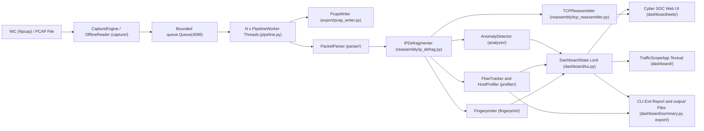

# TrafficScope

> **Dual-Mode Network Packet Sniffer, TCP Stream Reconstructor & Cyber SOC Analyzer**


**TrafficScope** is a multi-threaded Python network monitoring and passive traffic analysis tool for Windows 10/11. It captures live incoming and outgoing packets (or replays saved `.pcap` files), reconstructs TCP & HTTP sessions, inspects DNS/TLS SNI metadata, detects protocol and scan anomalies, profiles statistical baselines, passively fingerprints operating systems, and visualizes everything through either a **modern Cyber SOC Web Dashboard** (`--web`) or a **CLI / Terminal TUI Dashboard** (`--dashboard`).

---

## Quick Navigation

- [Overview & Core Features](#overview--core-features)
- [Installation & Setup (Windows 10/11)](#installation--setup-windows-1011)
- [How to Use TrafficScope (Dual Mode Guide)](#how-to-use-trafficscope-dual-mode-guide)
  - [Mode 1: Cyber SOC Web Dashboard (Zero Capture CLI Flags)](#mode-1-cyber-soc-web-dashboard-zero-capture-cli-flags)
  - [Mode 2: CLI & Terminal TUI Mode](#mode-2-cli--terminal-tui-mode)
  - [Full Command-Line Reference](#full-command-line-reference)
- [Saved Output Folders (`output/pcap/` & `output/json/`)](#saved-output-folders-outputpcap--outputjson)
- [What Gets Captured & Payload Privacy](#what-gets-captured--payload-privacy)
- [Architecture & Project Layout](#architecture--project-layout)
- [Threat Detection Rules & Reassembly](#threat-detection-rules--reassembly)
- [Benchmark Results](#benchmark-results)
- [Running Automated Tests](#running-automated-tests)
- [Limitations & False Positives](#limitations--false-positives)
- [Technology Stack](#technology-stack)
- [Legal & Ethical Use](#legal--ethical-use)
- [License & Acknowledgments](#license--acknowledgments)

---

## Overview & Core Features

> [!IMPORTANT]
> **Authorized & Passive Use Only:** TrafficScope operates **100% passively**—it never injects, crafts, or transmits network packets. Use it exclusively on loopback (`127.0.0.1`), personal lab VMs, or networks you own or have written permission to monitor. All alerts are analytical indicators for investigation, not confirmed intrusions.

### Key Features


- **Dual-Mode Operation:**
  - **Cyber SOC Web Dashboard (`--web`):** Localhost (`127.0.0.1:5000`) Flask web interface where you choose NICs, set filters, start/stop captures, upload/replay `.pcap` files, inspect Follow-TCP-Stream transcripts, and export JSON/CSV/PCAP files with **zero capture CLI commands**.
  - **Terminal TUI & CLI (`--dashboard` / `--verbose`):** Live 1-second refreshing Textual dashboard or Rich CLI monitor + exit report.
- **Non-Blocking Multi-Threaded Pipeline:** Dedicated capture/replay producer pushes into a bounded `queue.Queue(4096)` drained by parallel `PipelineWorker` threads ([pipeline.py](pipeline.py)), reporting queue and Npcap kernel drop counts.
- **Deep Layer-by-Layer Dissection:** Ethernet/Loopback, ARP, IPv4/IPv6, TCP/UDP/ICMP/ICMPv6, plus application metadata for **HTTP/1.x**, **DNS** (UDP & TCP), and **TLS `ClientHello`** (unencrypted SNI & ALPN).
- **IP Defragmentation & TCP Stream Reassembly:** Reassembles fragmented IPv4 datagrams and out-of-order/retransmitted TCP segments into sanitized Wireshark-style **Follow TCP Stream** transcripts and HTTP request/response pairs.
- **Anomaly Detection, Entropy & Passive OS Fingerprinting:** Flags bad checksums, invalid TTLs, `NULL`/`FIN`/`XMAS`/`SYN+FIN` scans, SYN floods, port sweeps, statistical rate/payload z-score spikes, byte Shannon entropy, and TCP `SYN` OS guesses.

---

## Installation & Setup (Windows 10/11)

> [!TIP]
> **Beginner Tip — Admin vs. Normal Terminal:**
>
> - **Offline PCAP Replay, Web UI Replay, Benchmarking & Tests:** Work in a **normal (non-Admin)** PowerShell window.
> - **Live NIC Packet Capture (CLI or Web UI):** Requires running PowerShell via **Run as administrator** so Windows allows raw Npcap packet capture.

### 1. Prerequisites

1. **Python 3.11+** (tested on Python `3.13.13`, 64-bit Windows 10/11). Check **"Add Python to PATH"** during installation.
2. **Npcap** (for live capture): Download from [npcap.com](https://npcap.com/#download) and during setup check **"Install Npcap in WinPcap API-compatible Mode"**.

### 2. Clone & Install Dependencies

```powershell
git clone https://github.com/Jaindu-Net/CodeAlpha_TrafficScope.git
cd CodeAlpha_TrafficScope

python -m venv .venv
.venv\Scripts\Activate.ps1

pip install -r requirements.txt
```

> [!NOTE]
> If PowerShell blocks `.venv\Scripts\Activate.ps1` with an execution policy error, run `Set-ExecutionPolicy -Scope CurrentUser RemoteSigned` once and retry.

### 3. Verify Interfaces Are Detected

```powershell
python main.py --iface ?
```

If your Wi-Fi / Ethernet adapters appear in the table, TrafficScope is ready to use.

---

## How to Use TrafficScope (Dual Mode Guide)

Choose whichever mode fits your workflow—both run on the exact same multi-threaded capture and detection engine.

---

### Mode 1: Cyber SOC Web Dashboard (Zero Capture CLI Flags)


Start the web server cleanly in PowerShell (bound strictly to **`127.0.0.1`** so external devices on your network cannot access it):

```powershell
# Launch Web Dashboard at http://127.0.0.1:5000 (auto-opens browser)
python main.py --web

# Custom port or prevent auto-opening the browser
python main.py --web --port 8080 --no-browser

# Pre-load an existing PCAP capture immediately when the dashboard opens
python main.py --web --read my_capture.pcap
```

> [!NOTE]
> TrafficScope opens at **`http://127.0.0.1:5000`** (or your chosen `--port`). Make sure you stop any old test server before starting a new one on the same port.

#### Step-by-Step A: Try Offline PCAP Analysis (No Admin Required)

1. Open a normal PowerShell window inside `CodeAlpha_TrafficScope`, activate `.venv`, and run:

   ```powershell
   python main.py --web
   ```

2. In your browser (`http://127.0.0.1:5000`), click **Replay .PCAP** and upload any `.pcap` / `.pcapng` / `.cap` file (for example `output/pcap/my_capture.pcap` or `output/pcap/http_test.pcap`).
   - Or click **Tuning & Privacy**, type a filename or path under **Or Replay Local Server PCAP Path** (e.g. `my_capture.pcap`), and click **Load Local Path**.
3. Explore all dashboard tabs:
   - **KPIs & Charts:** Packets/sec, byte volume, 60s Throughput & KB/s timeline, Protocol doughnut chart, Payload Entropy bars, and Top Talkers with Passive OS guesses.
   - **Live Packets:** Searchable packet table (`Filter IP, port, proto, domain...`).
   - **Flows & OS:** Bidirectional 5-tuple flows with passive OS fingerprint and **Follow Stream** button on TCP streams.
   - **Security Alerts:** Severity filter pills (**All** / **High** / **Medium** / **Low**) for scan and statistical alerts.
   - **DNS & TLS SNI / HTTP Sessions:** Domain queries, answer IPs, TLS `ClientHello` SNI domains, and reconstructed HTTP request/response pairs.

#### Step-by-Step B: Live Network Capture from the Browser (Admin Required)

1. Open PowerShell via **Run as administrator**, navigate to the project, activate `.venv`, and start:

   ```powershell
   python main.py --web
   ```

2. Notice the top status pill shows **ADMIN ELEVATED**.
3. Pick your active adapter from the **Network Interface** dropdown (formatted cleanly as `Adapter Name — IP`, e.g., `Intel(R) Wi-Fi 6 AX201 — 192.168.8.182`).
4. *(Optional)* Enter a BPF filter (e.g., `tcp port 80 or port 443`) or expand **Tuning & Privacy** to enable `--no-payload`, cap payload bytes, adjust worker threads, or set custom HTTP ports.
5. Click **Start Live Capture**, generate traffic in another tab, then click **Stop**.

#### Exporting Results from the Web Dashboard

Right next to **Export PCAP** is the **Export Format Dropdown + Export button**:

| Export Control / Option | Output Filename | Contents & When Available |
| --- | --- | --- |
| **Export Dropdown → `Full SOC Report (.json)`** | `trafficscope_report.json` | Complete session summary: KPIs, protocol counts, alerts, DNS, TLS SNI, HTTP, Top Hosts + OS, and flows *(live or stopped)* |
| **Export Dropdown → `Flows Summary (.json)`** | `trafficscope_flows.json` | Versioned NetFlow-style 5-tuple flow list *(live or stopped)* |
| **Export Dropdown → `Security Alerts (.csv)`** | `trafficscope_alerts.csv` | Triggered alerts table formatted for Excel with formula-injection neutralization *(live or stopped)* |
| **Export Dropdown → `Flows & OS (.csv)`** | `trafficscope_flows.csv` | Flows, passive OS guesses, packet/byte counters, and Shannon entropy *(live or stopped)* |
| **Export Dropdown → `Recent Packets (.csv)`** | `trafficscope_packets.csv` | Latest dissected packet table rows *(live or stopped)* |
| **Export PCAP** | `trafficscope_capture.pcap` | Full libpcap binary capture readable in Wireshark *(enabled after clicking **Stop**)* |

---

### Mode 2: CLI & Terminal TUI Mode


Use CLI commands directly for terminal monitoring, headless scripts, or quick offline PCAP inspection.

#### Offline Commands (No Admin Required)

```powershell
# 1. List available network interfaces
python main.py --iface ?

# 2. Replay a saved PCAP and print Wireshark-style TCP/HTTP transcripts
python main.py --read my_capture.pcap --follow-streams

# 3. Replay a saved PCAP with per-packet console logging + exit summary
python main.py --read http_test.pcap --follow-streams --verbose

# 4. Replay a saved PCAP inside the live Textual Terminal Dashboard (press 'q' to exit)
python main.py --read my_capture.pcap --dashboard

# 5. Replay using Privacy Mode (strip payloads) + custom HTTP ports
python main.py --read http_test.pcap --no-payload --http-ports 80,8080,8888 --verbose
```

#### Live Capture Commands (Administrator PowerShell Required)

```powershell
# 1. Live capture in the full-screen Textual TUI dashboard (press 'q' to quit cleanly)
python main.py --iface "Wi-Fi" --dashboard

# 2. Capture 500 HTTP/HTTPS packets and auto-save to output/pcap/ and output/json/
python main.py --iface "Ethernet" --filter "tcp port 80 or port 443" --count 500 --save web_session.pcap

# 3. Capture for 60s on custom HTTP ports with 2 workers and 120s statistical baseline
python main.py --iface "Wi-Fi" --http-ports 80,8080,8888 --timeout 60 --threads 2 --baseline-seconds 120 --verbose

# 4. Privacy-preserving header-only live capture (strips application payload bytes)
python main.py --iface "Wi-Fi" --no-payload --save headers_only.pcap --dashboard
```

> [!TIP]
> **Textual TUI Panels (`--dashboard`):** Displays a live Header Bar (NIC/PCAP source, `LIVE` / `COMPLETE` badge, elapsed time, pps, total packets, drops), Protocol Breakdown, Top Talkers + Passive OS, Payload Entropy Heatmap, and Severity-Colored Anomaly Feed. Press `q` at any time to shut down cleanly and display the Rich exit summary.

---

### Full Command-Line Reference

| Flag | Default | Description |
| --- | --- | --- |
| `--web` | `False` | Launch the local Cyber SOC Web Dashboard (`127.0.0.1`) |
| `--port` | `5000` | Port for `--web` HTTP server (`1`–`65535`) |
| `--no-browser` | `False` | Do not auto-open browser when starting `--web` |
| `--iface` | interactive prompt | Interface name, list index, NPF GUID, or `?` to list adapters |
| `--filter` | `None` | Optional BPF capture filter expression (e.g., `"tcp port 80"`) |
| `--count` | `None` | Stop automatically after capturing/reading `N` packets |
| `--timeout` | `None` | Stop live capture automatically after `N` seconds |
| `--save` | `None` | Save `.pcap` to `output/pcap/` and flow JSON to `output/json/` (or explicit path) |
| `--read` | `None` | Replay an existing `.pcap` file offline (checks `output/pcap/` for bare filenames) |
| `--threads` | `min(4, cpu_count-1)` | Number of parallel analysis worker threads |
| `--no-payload` | `False` | Strip `Raw` payload bytes immediately on capture (privacy mode) |
| `--payload-bytes` | `None` | Truncate `Raw` payload bytes per packet to at most `N` bytes |
| `--dashboard` | `False` | Launch the live Textual terminal TUI dashboard |
| `--baseline-seconds` | `60.0` | Learning warmup period before flagging per-host statistical deviations |
| `--syn-threshold` | `20` | Unanswered SYNs per 10s window before flagging `SYN_FLOOD` |
| `--port-threshold` | `15` | Distinct destination ports per 10s window before flagging `PORT_SWEEP` |
| `--z-threshold` | `2.5` | Absolute z-score threshold for host rate/payload deviation alerts |
| `--http-ports` | `80,8080,3000,8000,8008` | Comma-separated TCP ports dissected as HTTP |
| `--follow-streams` | `False` | Print reconstructed TCP stream conversations at CLI exit |
| `--verbose` | `False` | Print per-packet summaries and live alerts in CLI mode |

---

## Saved Output Folders (`output/pcap/` & `output/json/`)

TrafficScope organizes generated captures locally instead of cluttering the repository root:

- **`output/pcap/`** — Stores recorded `.pcap` capture files (e.g., `python main.py --save web_session.pcap` writes `output/pcap/web_session.pcap`; Web UI live captures save `output/pcap/live_<timestamp>.pcap`).
- **`output/json/`** — Stores accompanying `*_flows.json` flow summaries (`output/json/web_session_flows.json`, `output/json/live_<timestamp>_flows.json`, and Web UI replay flow logs).
- **Bare filename lookup:** Running `python main.py --read web_session.pcap` automatically finds `output/pcap/web_session.pcap` even without typing the folder prefix. *(Providing a full custom path like `D:\lab\test.pcap` preserves that exact location.)*

> [!NOTE]
> `output/` (along with `*.pcap`, `*.pcapng`, `*.cap`, and `*_flows.json`) is listed in [.gitignore](.gitignore) so local packet captures and flow exports **are never pushed to GitHub**. Capture directories are created automatically on demand when running a capture.

---

## What Gets Captured & Payload Privacy

- **Bidirectional Traffic (Inbound & Outbound):** Captures both outgoing requests from your PC and incoming replies across the selected interface.
- **Addressing & Ports:** IPv4 and IPv6 source/destination IPs, TCP/UDP source/destination ports, ICMP type/code, and Ethernet MAC addresses.
- **Payloads:**
  - **Raw PCAP Archive:** Captures full payload bytes into `.pcap` unless `--no-payload` or `--payload-bytes` is enabled.
  - **Plaintext Protocols (`HTTP`, `DNS`, unencrypted TCP):** Readable in **Follow Stream** and **HTTP Sessions** (with terminal/ANSI escape sequences stripped for safety).
  - **Encrypted Traffic (`HTTPS` / `TLS` / `QUIC`):** TrafficScope never attempts decryption; instead it extracts **TLS `ClientHello` SNI domains** / ALPN and classifies payload randomness via **Shannon entropy** (`plaintext`, `compressed/mixed`, `likely encrypted`).

---

## Architecture & Project Layout

TrafficScope enforces strict module boundaries around a decoupled producer-consumer pipeline:



### Project Modules

| Path | Responsibility |
| --- | --- |
| [main.py](main.py) | Dual-mode CLI and `--web` entry point (contains zero scanning or dissection logic) |
| [pipeline.py](pipeline.py) | Shared multi-threaded pipeline coordinator, path resolver (`output/pcap/`, `output/json/`), and graceful shutdown |
| [capture/](capture/) | Live capture (`CaptureEngine`), offline PCAP replay (`OfflineReader`), elevation checks, and interface selector |
| [parser/](parser/) | Stateless layer-by-layer dissector returning immutable `ParsedPacket` records |
| [reassembly/](reassembly/) | IPv4 datagram defragmentation (`IPDefragmenter`) and sequence-ordered TCP stream reassembly (`TCPReassembler`) |
| [analyzer/](analyzer/) | Decoupled rule engine (`ChecksumRule`, `TTLRule`, `FlagRule`, `ScanDetector`) with 60s alert cooldown deduplication |
| [profiler/](profiler/) | 5-tuple `FlowTracker`, byte-level Shannon entropy, and rolling per-host z-score anomaly detection (`HostProfiler`) |
| [fingerprint/](fingerprint/) | Passive TCP `SYN` OS fingerprinting backed by `fingerprint/db/fingerprints.json` |
| [dashboard/](dashboard/) | Flask Cyber SOC Web Dashboard (`dashboard/web/`), Textual live TUI (`tui.py`), and Rich exit report (`summary.py`) |
| [export/](export/) | Thread-safe libpcap `PcapWriter` and versioned NetFlow JSON `FlowExporter` |
| [benchmark.py](benchmark.py) | Standalone synthetic PCAP generator and throughput benchmark logging to [docs/benchmark_results.md](docs/benchmark_results.md) |
| [tests/](tests/) | Admin-free `pytest` suite driven by synthetic Scapy packets, `IterSocket`, and Flask `test_client()` |
| `output/pcap/`, `output/json/` | Local gitignored folders created automatically for saved `.pcap` captures and `*_flows.json` exports |

---

## Threat Detection Rules & Reassembly

| Rule / Alert Type | Condition | Severity |
| --- | --- | --- |
| `INVALID_CHECKSUM` | IPv4 header or TCP/UDP/ICMP checksum fails RFC 1071 verification | `LOW` |
| `TTL_ANOMALY` | Packet arrives with illegal `TTL=0` (`HIGH`) or unicast `TTL<=1` (`MEDIUM`) | `HIGH` / `MEDIUM` |
| `SCAN_NULL` | TCP packet with zero classic control flags set | `MEDIUM` |
| `SCAN_FIN` | TCP packet with only `FIN` set (no `ACK`) | `MEDIUM` |
| `SCAN_XMAS` | TCP packet with `FIN+PSH+URG` set (no `ACK`) | `HIGH` |
| `SYN_FIN_ILLEGAL` | Illegal TCP `SYN+FIN` flag combination | `HIGH` |
| `RESERVED_FLAG` | Non-zero bits set in the TCP reserved header field | `MEDIUM` |
| `SYN_FLOOD` | Same `(src_ip, dst_ip)` exceeds `--syn-threshold` (default `> 20`) unanswered SYNs in `10s` | `HIGH` |
| `PORT_SWEEP` | Same `src_ip` touches more than `--port-threshold` (default `> 15`) distinct ports in `10s` | `HIGH` |
| `STATISTICAL_ANOMALY` | Host 1s rate or payload size exceeds rolling baseline by `abs(z-score) > 2.5`, or unseen protocol appears after warmup | `MEDIUM` |

### Why TCP Reassembly & IP Defragmentation Are Needed

1. **Multi-segment payloads:** HTTP messages often span multiple TCP frames—reassembly reveals the complete header and body.
2. **Out-of-order delivery:** Segments arriving out of sequence (`seq=1028` before `seq=1001`) are buffered and ordered via 32-bit sequence arithmetic.
3. **Retransmissions:** Duplicate TCP sequence ranges are deduplicated so reconstructed text never repeats.
4. **IP fragmentation:** Only fragment offset `0` carries transport headers (`TCP`/`UDP`/`ICMP`), so `IPDefragmenter` reconstructs complete IP datagrams before analysis.

---

## Benchmark Results

Measured locally via `python benchmark.py --generate 5000` (see [docs/benchmark_results.md](docs/benchmark_results.md)):

- **Environment:** Windows 11 (`Windows-11-10.0.26200-SP0`), Python `3.13.13`, 16 logical CPUs
- **Dataset:** 5,000 synthetic mixed packets (HTTP over TCP, DNS over UDP, TCP SYNs)

| Mode | Workers | Packets | Duration (s) | Sustained Throughput (pps) | MB/s |
| --- | ---: | ---: | ---: | ---: | ---: |
| Raw `PacketParser` Loop | 1 | 5,000 | 0.407 | **12,274.0** | 0.88 |
| Full Analysis Pipeline | 1 | 5,000 | 1.480 | 3,378.4 | 0.24 |
| Full Analysis Pipeline | 2 | 5,000 | 1.391 | **3,594.9** | 0.26 |
| Full Analysis Pipeline | 4 | 5,000 | 1.471 | 3,399.4 | 0.24 |

Throughput peaks around **~3,595 pps** with 2 workers in the full pipeline (`~12,274 pps` raw dissection), comfortably covering normal desktop browsing and file downloads without queue drops.

---

## Running Automated Tests

All 52 automated unit and integration tests run **without Administrator rights** using synthetic Scapy packets, `IterSocket`, and Flask's `test_client()`:

```powershell
# Run the full test suite
pytest tests/ -v

# Run only web dashboard & export tests
pytest tests/test_web.py -v

# Run replay throughput benchmark
python benchmark.py --generate 5000
```

> [!WARNING]
> Live NIC sniffing and external `nmap` scan validation require running inside an elevated Windows PowerShell terminal with Npcap installed.

---

## Limitations & False Positives

- **NIC Checksum Offloading (`INVALID_CHECKSUM`):** Windows often passes outbound frames to Npcap before the NIC computes hardware checksums, triggering `LOW` checksum alerts on local outbound packets.
- **Discovery & QUIC Chatter (`PORT_SWEEP` / `TTL_ANOMALY`):** Multicast (`224.0.0.0/4`, `ff00::/8`) and link-local addresses are ignored by `TTLRule`, but browsers opening many ephemeral UDP/QUIC ports can trigger `PORT_SWEEP` under low `--port-threshold` settings.
- **Encrypted DNS & QUIC:** Passive inspection cannot decrypt DoH/DoT (port `853`) or QUIC payloads; QUIC flows show as `UDP` with high Shannon entropy.
- **Baseline Warmup:** `HostProfiler` intentionally suppresses rate-deviation alerts during `--baseline-seconds` (default `60s`, minimum `5s` history).
- **Port-Based App Dispatch & TCP Extensions:** HTTP/DNS/TLS parsers dispatch by standard port sets (use `--http-ports` for non-standard HTTP ports), and `TCPReassembler` does not decode SACK option blocks or TCP Fast Open data inside `SYN`.

---

## Technology Stack

| Component | Technology |
| --- | --- |
| Packet Capture & PCAP I/O | `Scapy 2.8+` + `Npcap` (WinPcap-compatible mode) |
| Cyber SOC Web Dashboard | `Flask 3+` + `Chart.js` + XSS-safe Vanilla JS (`127.0.0.1`) |
| Terminal TUI & CLI UI | `Textual` + `Rich` |
| Statistical Profiling & Entropy | `NumPy` + `Pandas` + `scikit-learn` |
| Concurrency | Python `threading` + `queue.Queue` |
| Passive OS Database | Local JSON (`fingerprint/db/fingerprints.json`) |
| Reports & Data Exports | Libpcap `.pcap`, NetFlow/SOC `.json`, Excel-safe UTF-8 `.csv` |
| Testing | `pytest` (52 synthetic-packet & web integration tests) |
| Language & Platform | Python 3.11+ on Windows 10/11 |

---

## Legal & Ethical Use

- Run TrafficScope **only** on loopback (`127.0.0.1`), personal lab VMs, or networks you own or have explicit written authorization to inspect.
- TrafficScope never injects, alters, or transmits packets onto the wire.
- Always enable `--no-payload` (or **Privacy Mode** in the Web Dashboard) when demonstrating or storing captures that may include unencrypted credentials or tokens.

---

## License & Acknowledgments

- **License:** Licensed under the MIT License — see [LICENSE](LICENSE) for full text.
- **CodeAlpha:** Cyber Security Internship Program (`CodeAlpha_TrafficScope`).
- **Open-Source Libraries:** Scapy, Flask, Chart.js, Textual, Rich, NumPy, Pandas, scikit-learn, and pytest.

---

**Developed by Jaindu De Zoysa** — *CodeAlpha Cyber Security Internship (Task 01)*
