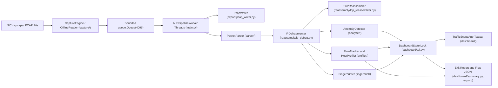

# TrafficScope Architecture

TrafficScope enforces strict module boundaries around a thread-safe producer-consumer pipeline so packet capture never blocks downstream dissection or analysis under load.

## Data Flow

## Key Design Boundaries

1. **Non-blocking Producer (`capture/`):** `CaptureEngine` uses `queue.put_nowait()` so slow analysis never stalls Npcap ring reads. Dropped packets are counted explicitly alongside Npcap `pcap_stats()` kernel drop counters.
2. **Immutable Canonical Contract (`parser/parsed_packet.py`):** `ParsedPacket` is a frozen dataclass (`slots=True`), guaranteeing thread-safe sharing across downstream stages.
3. **Decoupled Anomaly Detection (`analyzer/`):** Imports only `ParsedPacket` and stdlib types; contains zero imports from `capture/`, `reassembly/`, `export/`, or `dashboard/`.
4. **Polling UI Bridge (`dashboard/`):** Worker threads update `DashboardState` under a short lock; the Textual event loop reads immutable snapshots on a 1-second timer without cross-thread widget mutations.
